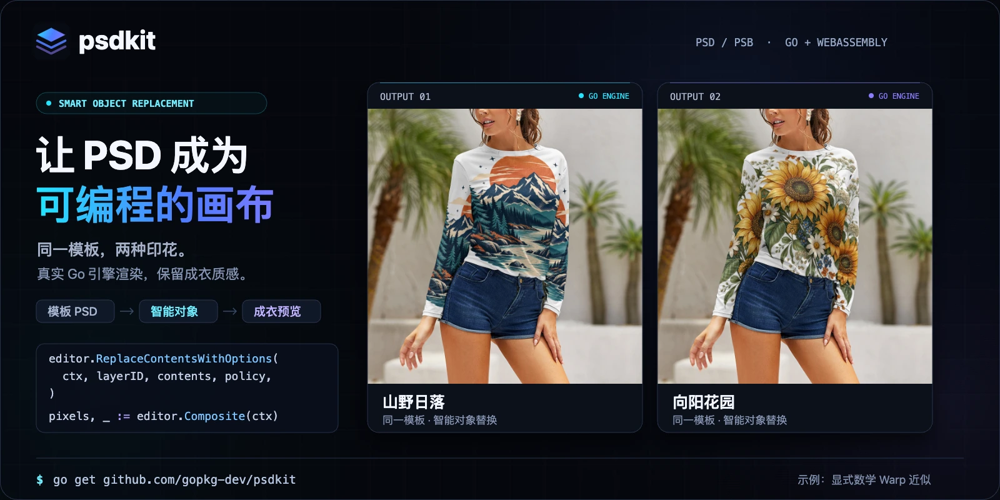

# psdkit

纯 Go 的 Photoshop PSD/PSB 读取、受控编辑、保存与渲染工具库。

[](https://psdkit.asin1.com/demo/)

- Go **1.27.3+**，核心库仅依赖标准库。
- 按需读取原位深通道，保留未知块、原始区间和可编辑结构。
- 提供 RGB8 合成、智能对象、文字、矢量、ICC 和部分高位深能力。
- 同一份 Go 实现可编译到 WebAssembly，在浏览器 Worker 中运行。

当前处于早期开发阶段，部分高级语义受限制，见 [能力状态与路线图](docs/status.md)。
读取、保存、显示保存预览和实时重绘是不同能力；不承诺任意文档与 Photoshop 像素一致。

## 安装

安装模块：

```sh
go get github.com/gopkg-dev/psdkit@v0.3.0
```

`v0.3.0` 的新增能力和升级范围见[发布说明](docs/releases/v0.3.0.md)，支持边界以[该 Tag 的矩阵](https://github.com/gopkg-dev/psdkit/blob/v0.3.0/docs/status.md)为准。`v0.2.0` 的[历史交付验收记录](docs/releases/verification-2026-10-24.md)保留当时的固定提交、运行链接和校验和。

## 快速开始

```go
package main

import (
	"context"
	"log"

	"github.com/gopkg-dev/psdkit"
)

func main() {
	ctx := context.Background()
	editor, err := psdkit.CreateDocument(ctx, 640, 480)
	if err != nil {
		log.Fatal(err)
	}
	defer func() { _ = editor.Close() }()
	if err := editor.SavePSD(ctx, "example.psd"); err != nil {
		log.Print(err)
	}
}
```

无需外部素材即可运行：

```sh
go run ./examples/create -out /tmp/example.psd
go run ./examples/index -psd /tmp/example.psd
go run ./examples/edit -psd /tmp/example.psd -out /tmp/edited.psd
```

## 文档与开发

- [使用文档](docs/guide/index.md)、[快速开始](docs/guide/quickstart.md)、[运行示例](examples/README.md)、[能力矩阵](docs/status.md)。
- [浏览器 Demo](web/demo/README.md)、[Worker SDK](web/sdk/README.md)。
- [贡献指南](.github/CONTRIBUTING.md)、[测试与素材](docs/testing.md)、[仓库边界](docs/repository.md)。
- [GitHub Pages 部署](docs/deployment.md)、[网站设计规范](docs/design-handoff.md)。

Pages 工作流把首页与文档放在站点根路径，把 Playground 放在 `demo/`。站点地址为
[首页与文档](https://psdkit.asin1.com/) 和 [Playground](https://psdkit.asin1.com/demo/)。

```sh
make check       # 测试、vet、lint、格式和 SDK 测试。
make race        # Go 竞态检测。
make web         # Wasm、示例 PSD 与 Playground，需要 Node.js 24。
make site        # 文档 + Playground 组装到 _site/，需要 Ruby/Bundler。
make site-preview  # 在 http://127.0.0.1:8301/psdkit/ 预览完整站点。
```

`make tools` 在本仓库 `.tools/` 安装固定版本 golangci-lint，不修改全局工具。
小型回归素材跟随包；大型 oracle、私有样例和研发记录已独立存放。

项目采用 [MIT](LICENSE)。第三方代码和素材见 [来源与许可](docs/third-party-notices.md)。
